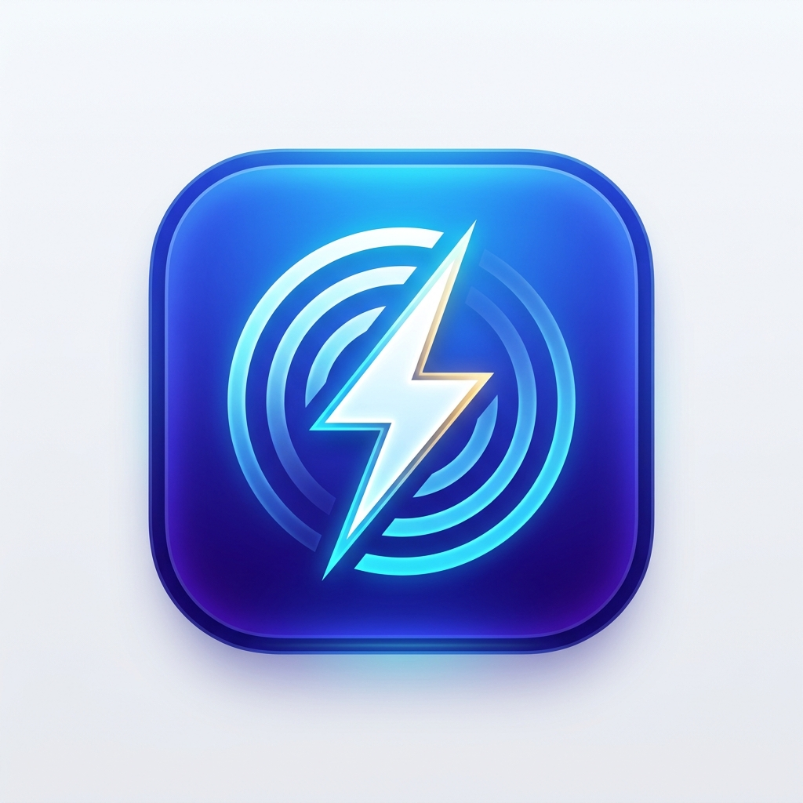

<div align="center">



# ZeroDrop

**Free, zero-install, <400 KB desktop transfer hub with LAN Burn-After-Read & Optical QR Air-Gap.**  
**免费、免安装、不足 400KB 的桌面端跨设备快传工具：局域网阅后即焚 + 光学二维码气隙空投。**

[](https://github.com/kinson5/ZeroDrop/releases/tag/v1.0.0)
[](./LICENSE)
[-orange.svg?style=flat-square)](https://github.com/kinson5/ZeroDrop/releases/latest)
[](https://github.com/kinson5/ZeroDrop/releases/latest)
[](#%E4%B8%AD%E6%96%87%E4%BB%8B%E7%BB%8D)

[简体中文](#中文介绍) | [English](#english) | [立即下载 / Downloads](#下载与校验-downloads) | [iPhone 配套端](#zerodrop-for-iphone)

</div>

---

## 📦 下载与校验 (Downloads)

从 [GitHub Releases v1.0.0](https://github.com/kinson5/ZeroDrop/releases/tag/v1.0.0) 直接免费下载对应平台的独立可执行程序（单文件分发，零运行库依赖）：

| 平台 (Platform) | 下载文件 (Download) | 体积 (Size) | 架构与兼容性 (Compatibility) |
| :--- | :--- | :--- | :--- |
| **Windows (.exe 直下)** | [`ZeroDrop_win.exe`](https://github.com/kinson5/ZeroDrop/releases/download/v1.0.0/ZeroDrop_win.exe) | 400 KB | 静态编译 PE32，兼容 Windows XP ~ Windows 11/12 |
| **Windows (ZIP 压缩包)** | [`ZeroDrop-v1.0.0-Windows.zip`](https://github.com/kinson5/ZeroDrop/releases/download/v1.0.0/ZeroDrop-v1.0.0-Windows.zip) | 207 KB | 内含 `ZeroDrop_win.exe` |
| **macOS (通用二进制 ZIP)** | [`ZeroDrop-v1.0.0-macOS.zip`](https://github.com/kinson5/ZeroDrop/releases/download/v1.0.0/ZeroDrop-v1.0.0-macOS.zip) | 111 KB | Universal Mach-O (`arm64` M1–M4 + `x86_64` Intel，解压 332 KB) |
| **SHA-256 校验文件** | [`SHA256SUMS.txt`](https://github.com/kinson5/ZeroDrop/releases/download/v1.0.0/SHA256SUMS.txt) | 269 B | 用于校验下载文件完整性 |

---

<a name="中文介绍"></a>
## 🇨🇳 中文介绍

### 💡 为什么选择 ZeroDrop？

日常在电脑（Windows / Mac）与手机（iPhone / Android）之间传文字、链接、截图或文档时，登录社交账号不仅繁琐，还容易留下云端缓存。甚至在**完全没有 Wi-Fi / 隔绝内网**的环境下，传统局域网工具也无能为力。

**ZeroDrop** 将所有能力浓缩进一个不到 **400 KB** 的单文件程序，双击运行即刻在本地启动轻量级 Web 控制台，同时提供**局域网极速快传**与**免连网光学二维码空投**两种模式。

### ✨ 核心亮点

- **📷 光学二维码气隙空投 (Optical QR Air-Gap)**
  - **彻底无需连网**：不依赖 Wi-Fi、蓝牙或同一个局域网，仅凭屏幕光学显示 + 手机摄像头即可隔空传输文本、照片与文件。
  - **高速分段喷泉码 (`ZDS:`)**：内置与 iPhone 端逐字节兼容的 `ZeroDrop ZDS` 分段喷泉码引擎；短纯文本（≤300 字节）秒出静态码，长文本/图片/文档自动分块并插帧校验。
  - **同屏多码与帧率预设**：开播前自由选择 `1×1 单码稳定` / `1×2 双码均衡（默认）` / `2×2 四码极速`，支持 `16 FPS` / `10 FPS` 切换与全屏高帧率无卡顿播放。
  - **分类限额与智能加速**：图片上限 **5 MB**（大图自动在浏览器端缩放压缩提速）、文档/文本上限 **3 MB**、其他文件上限 **1 MB**；多段文件自带**断点续传起始段滑块**，中途移开相机后可直接从指定段续传。
- **⚡ 局域网极速快传 (LAN Quick Transfer)**
  - 同一 Wi-Fi 下，手机相机扫描顶栏「📱 扫码连入」二维码即可打开网页开始收发，**手机无需强制装 App**。
  - 支持在线设备发现、全员广播或指定设备定向私传，支持电脑剪贴板双向读取与自动写入。
- **🔥 极致隐私与阅后即焚 (Burn-After-Read · Zero Trace)**
  - **纯内存流转**：消息仅驻留于内存，无数据库、无账号、无云端中转、**零遥测/零后台外连**。
  - **下载即焚 & 退出清盘**：私密定向文件一旦被接收方下载，服务端立即物理擦除；网页支持「🔥 焚毁」随时抹除，程序退出时自动彻底清理所有临时文件。
- **🪶 超轻单文件 & 原生双语**
  - 免安装 Python / Node.js / .NET 运行库，支持界面与控制台中文 / English 一键切换。

### 🚀 快速上手

1. 下载并解压运行 `ZeroDrop_win.exe`（Windows）或 `ZeroDrop_mac`（macOS）。
2. 程序会自动探测本机最优局域网 IP、在默认浏览器打开简洁的双标签控制台：
   - **⚡ 局域网快传**：手机用自带相机扫码加入，即可互传大文本、同步电脑剪贴板或传输文件。
   - **📷 光学空投**：无需联网，选择好 `1×2 / 2×2` 与 `16 FPS`，直接拖入照片/文档或输入文本即可用手机端 **ZeroDrop** 扫码接收。

#### 命令行可选参数
```bash
./ZeroDrop_mac                # 默认端口 8080 启动（若被占用自动顺延）
./ZeroDrop_mac 8888           # 指定端口 8888
./ZeroDrop_mac --lang en      # 强制以英文启动 (--lang zh 为中文)
```

#### 首次运行系统提示处理
- **macOS**：首次运行如遇权限或“无法验证开发者”提示，可在终端进入所在目录执行：
  ```bash
  chmod +x ZeroDrop_mac
  xattr -dr com.apple.quarantine ZeroDrop_mac
  ./ZeroDrop_mac
  ```
- **Windows**：若 Windows SmartScreen 弹出“Windows 已保护你的电脑”，点击「更多信息」→「仍要运行」即可。

---

<a name="zerodrop-for-iphone"></a>
## 📱 ZeroDrop for iPhone（即将上架 App Store）

桌面端 **ZeroDrop（Windows / macOS）** 可与即将上架的 **ZeroDrop iOS（iPhone / iPad）** 无缝协同：

- 📷 **高速光学气隙接收**：多核实时识别桌面端发射的 `1×1 / 1×2 / 2×2` 动态 `ZDS:` 光学喷泉码，支持中断进度磁盘断点续传。
- 📤 **系统级「分享」一键快传**：在相册、文件、微信或 Safari 中点「分享 → ZeroDrop」，免打开主程序秒传电脑。
- 🤝 **离线点对点互传 + 局域网 PIN 安全门控**：无公网环境下与附近设备暗号配对互传，兼顾速度与隐私。

> **状态预告**：**ZeroDrop iOS 版正在准备上架 App Store**（桌面端界面底部及光学播放窗已预留跳转入口）。正式上架后将在本页面及 Release 更新正式下载链接，欢迎 **Star / Watch 本仓库** 获取上线通知！

---

<a name="english"></a>
## 🇬🇧 English

### 💡 What is ZeroDrop?

**ZeroDrop** is a free, zero-install, single-binary desktop transfer hub (**under 400 KB**) built for Windows and macOS. It gives you an instant local web console with two privacy-first transfer engines:

- **📷 Optical QR Air-Gap Transmission (`ZeroDrop ZDS`)**: Beam text, compressed photos (**≤5 MB**), documents (**≤3 MB**), and small files (**≤1 MB**) straight from your monitor to your iPhone camera with **zero Wi-Fi, zero Bluetooth, and zero network connection**. Supports pre-transfer `1×1` / `1×2` (default) / `2×2` multi-QR grids, `16 / 10 FPS` playback, and segment-level resume.
- **⚡ LAN Quick Transfer & Burn-After-Read**: Open on any phone via QR code over the same Wi-Fi. Broadcast or send privately, sync PC clipboard both ways, and keep everything strictly in RAM with **physical burn-on-download** and **complete temp wipe on exit**.
- **🔒 Zero Telemetry & Free Forever**: Compiled native binaries with zero cloud servers, zero accounts, and zero outbound tracking requests.

### Quick Start

1. Download [`ZeroDrop_win.exe`](https://github.com/kinson5/ZeroDrop/releases/download/v1.0.0/ZeroDrop_win.exe) (Windows XP–12) or [`ZeroDrop-v1.0.0-macOS.zip`](https://github.com/kinson5/ZeroDrop/releases/download/v1.0.0/ZeroDrop-v1.0.0-macOS.zip) (macOS Apple Silicon & Intel).
2. Double-click or run from terminal (`./ZeroDrop_mac [port] [--lang en|zh]`). Your browser opens automatically.
3. On macOS, if Gatekeeper prompts on first launch:
   ```bash
   chmod +x ZeroDrop_mac && xattr -dr com.apple.quarantine ZeroDrop_mac && ./ZeroDrop_mac
   ```

### SHA-256 Verification
Checksums are published alongside every release in [`SHA256SUMS.txt`](https://github.com/kinson5/ZeroDrop/releases/download/v1.0.0/SHA256SUMS.txt):
```bash
shasum -a 256 -c SHA256SUMS.txt
```

---

### 👨‍💻 Author & License

- **Author**: Kinson Wu  
- **Distribution**: Freeware binary release under [LICENSE](./LICENSE) (compiled executables only; source code not included).
